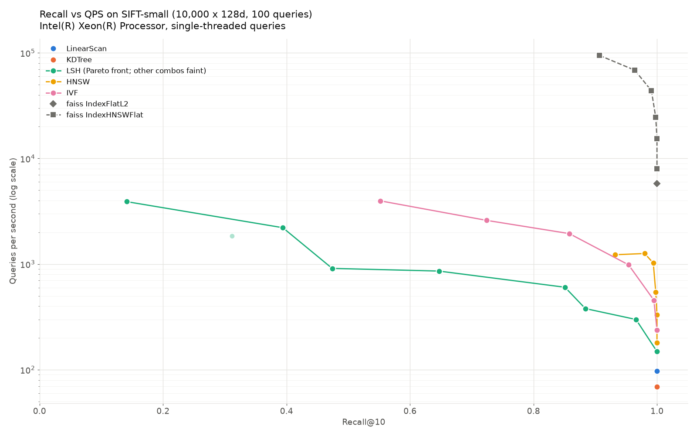
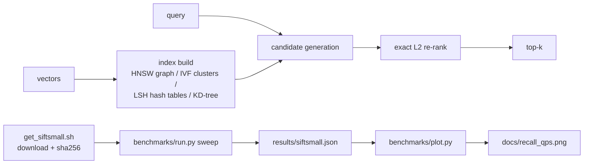

# vector-db-from-scratch

[](https://github.com/PeterP22/vector-db-from-scratch/actions/workflows/ci.yml)
[](LICENSE)

Five ANN indexes (linear scan, KD-tree, LSH, HNSW, IVF) written from first principles in Python/NumPy, benchmarked against faiss.

**HNSW reaches recall@10 0.980 at 1,260.5 QPS (ef=20), 12.9x the exact LinearScan's 97.6 QPS. faiss IndexHNSWFlat, built with the same M/efConstruction, does 43,783.7 QPS at recall 0.991 (efSearch=40), 34.7x faster than this pure-Python HNSW.** All numbers are from `results/siftsmall.json`.



## How it works



## Key decisions

- QPS is single-query wall clock on one thread (faiss pinned with `omp_set_num_threads(1)`), so faiss works as a fair reference rather than a multi-core outlier.
- Recall@10 is measured against the exact L2 ground truth that ships with SIFT-small, not against our own linear scan.
- LSH buckets by random hyperplanes through the origin (cosine), then re-ranks the union of candidates by exact L2.
- What didn't work: the KD-tree is exact but runs at 69.3 QPS vs 97.6 for the linear scan (0.71x) because branch-and-bound pruning collapses at 128 dimensions. LSH needs 32 tables to pass 0.96 recall; with 8 tables it tops out at 0.884.

## Results

| index | params | recall@10 | QPS | build s |
|---|---|---|---|---|
| LinearScan | exact | 1.000 | 97.6 | <0.01 |
| KDTree | exact | 1.000 | 69.3 | 0.03 |
| LSH | 32 tables x 12 bits | 0.966 | 299.5 | 2.30 |
| LSH | 32 tables x 8 bits | 1.000 | 149.0 | 1.42 |
| HNSW | M=16, efC=100, ef=20 | 0.980 | 1,260.5 | 53.38 |
| HNSW | M=16, efC=100, ef=160 | 1.000 | 331.3 | 53.38 |
| IVF | 100 clusters, n_probe=8 | 0.954 | 985.1 | 35.00 |
| IVF | 100 clusters, n_probe=32 | 1.000 | 238.2 | 35.00 |
| faiss IndexFlatL2 (reference) | exact | 1.000 | 5,763.0 | <0.01 |
| faiss IndexHNSWFlat (reference) | M=16, efC=100, efSearch=20 | 0.964 | 68,477.1 | 0.49 |
| faiss IndexHNSWFlat (reference) | M=16, efC=100, efSearch=160 | 1.000 | 15,436.7 | 0.49 |

SIFT-small (10,000 base vectors x 128 dims, 100 queries, k=10) on an 8-vCPU Intel Xeon VM with Python 3.13.5, numpy 2.5.4 and faiss-cpu 1.15.1: single-threaded queries, one run, from `results/siftsmall.json`. To reproduce, run the Quickstart. The box is a shared VM, so QPS varies from run to run (a rerun aborted under heavy contention measured roughly half the QPS). Recall is deterministic.

## Quickstart

```bash
git clone https://github.com/PeterP22/vector-db-from-scratch.git && cd vector-db-from-scratch
pip install -r requirements.txt faiss-cpu
./scripts/get_siftsmall.sh && python benchmarks/run.py --data siftsmall --dir data && python benchmarks/plot.py results/siftsmall.json
```

Also in this repo: RAG examples with Nvidia Nemotron embeddings and Kimi K2 in [`examples/`](examples/).

---

MIT · built by Peter Preketes
